### Hi，我是 QFeng

写代码的，这几年主要在做 Word 文档的自动排版。
后端 Python / .NET，前端 Vue，偶尔写点 Go 和 Rust。

**最近在弄**

- [nginxpulse-neo](https://github.com/qfcxhh/nginxpulse-neo) — 轻量的 Nginx 访问日志分析面板
- [python-docx](https://github.com/qfcxhh/python-docx)（fork）— 补了些日常用得上的功能

<picture>
  <source media="(prefers-color-scheme: dark)" srcset="./profile/top-langs-dark.svg" />
  
</picture>

<picture>
  <source media="(prefers-color-scheme: dark)" srcset="https://raw.githubusercontent.com/qfcxhh/qfcxhh/output/github-contribution-grid-snake-dark.svg" />
  
</picture>
